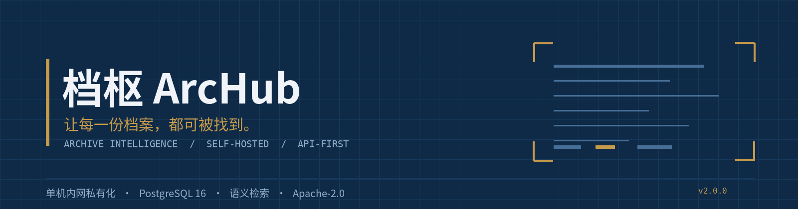
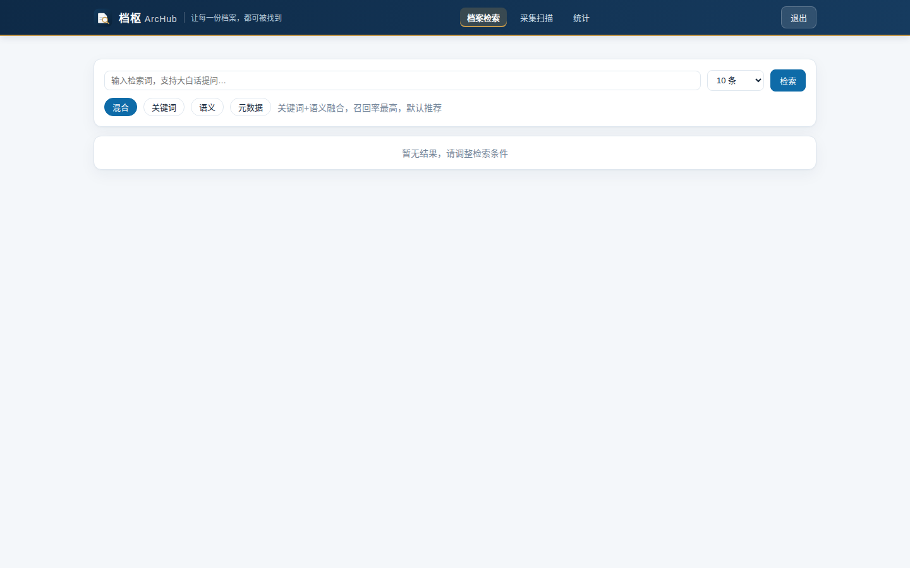
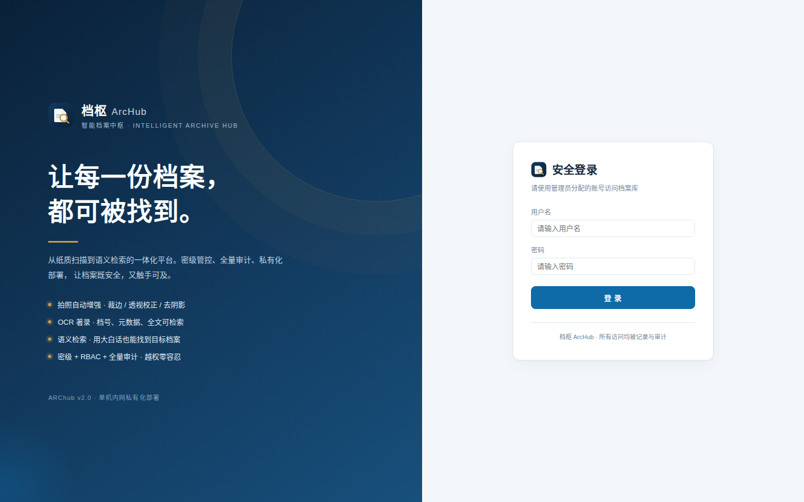

# 档枢 ArcHub · 智能档案中枢

**Current version / 当前版本：2.3.0**（源自 [CHANGELOG.md](CHANGELOG.md)）

> **让每一份档案，都可被找到。**
>
> 扫描归档 → OCR 著录 → 密级管控 → 全文/语义检索 → 全量审计，一体化单机内网私有化平台。



[](LICENSE)
[](https://github.com/x2it/arhub/actions/workflows/ci.yml)
[](requirements-gateway.txt)
[](frontend/package.json)
[](docker-compose.yml)
[](docker-compose.yml)

> **在线演示**：本项目面向内网私有化，不提供公共演示实例；按[快速开始](#快速开始)起栈后访问 `http://127.0.0.1:8700` 即为完整系统，实测截图见下方。

把纸质档案扫描成电子件，自动 OCR 著录，自动建立语义索引，再通过统一 API / Web 工作台按**档号、关键词、自然语言**检索。面向**单机内网私有化**部署：登录鉴权、四级 RBAC、四级密级、全量审计、备份恢复，开箱即用。

**ArcHub** is a self-hosted, intranet-first archive intelligence platform: scan enhancement, OCR ingestion, classification-based access control, full-text and semantic search, and a complete audit trail behind one API gateway. Six containers, one exposed port, no external services.



<p align="center"></p>

<sub>更多实测截图：[检索页](docs/live_search.png) · [拍照采集台](docs/ui_capture.png) · [全部截图](docs/)</sub>

> v1 是能跑通的原型；v2 是系统性重做：SQLite → PostgreSQL、无鉴权 → JWT + RBAC + 密级 fail-closed、
> 串行检索 → 并发 + 熔断降级、手动索引 → outbox 流水线、命令行 → 8 页 Web 工作台。
> 变更详见 [CHANGELOG.md](CHANGELOG.md)。

---

## 这是什么

| | |
|---|---|
| **定位** | 对齐扫描全能王 / Microsoft Lens 的图像增强，并向后打通档案级全链路 |
| **部署形态** | 单机内网私有化，6 容器，仅暴露网关一个端口 |
| **技术栈** | Python 3.11 / FastAPI / PostgreSQL 16 / Redis 7 / Vue 3 + Vite + TS / OpenCV |
| **许可证** | [Apache-2.0](LICENSE) · [NOTICE](NOTICE) |

市面上的扫描 App 止于「把图变清楚」，档案管理系统又往往从「已有电子文件」开始。
档枢把这中间断开的一段接上：**一张照片 → 增强 → OCR → 著录 → 密级 → 语义索引 → 检索 → 审计**，
全部收口在一个网关后面，且数据不出内网。

| | 常见做法 | 本项目的做法 |
|---|---|---|
| 图像增强 | 客户端滤镜，结果不入库 | 服务端 OpenCV 增强，原图/增强后对比确认后再归档 |
| 中文检索 | 依赖全文引擎分词 | PostgreSQL `ILIKE + pg_trgm` 承担关键词，中文子串准确可用 |
| 语义检索 | 引入独立向量数据库 | 512 维常驻矩阵 + `argpartition`，单机 5–20ms，无额外组件 |
| 权限 | 只在文档系统侧控制 | 网关统一裁决，语义检索路同样过滤，密级缺失即拒绝 |
| 索引 | OCR 后同步建索引 | outbox 流水线 + 退避重试 + 启动对账，最终一定被索引 |
| 部署 | 多个端口、多个服务暴露 | 仅 `8700` 对外，其余组件只在内网容器网络可达 |

---

## 架构

```
        扫描仪 / 手机拍照 / 电子文件
                    │
       ┌────────────┴─────────────┐
       │  Web 拍照台（Vue3）        │  服务端 OpenCV 增强：裁边·透视校正
       │  上传原图→增强对比→归档    │  去阴影·CLAHE·二值化·空白页检测
       └────────────┬─────────────┘
                    ▼
   ┌─── 网关 :8700（唯一对外端口）──────────────────────────┐
   │  JWT 鉴权 · 四级 RBAC · 密级越权过滤(fail-closed)      │
   │  审计落库 · 请求ID · 令牌桶限流 · 统一错误 · 静态托管   │
   └──┬──────────────────┬───────────────────────┬─────────┘
      ▼                  ▼                       ▼
 Paperless-ngx     语义检索服务 :8600      索引流水线 worker
 OCR·档号·元数据    BGE 向量·常驻矩阵      outbox 消费·退避重试
 全文索引·扫描件    (唯一自研检索内核)      对账·删除同步
      │                  │                       │
      └──────────┬───────┴───────────────────────┘
                 ▼
        PostgreSQL 16（archive 业务库 + archive_vec 向量库）· Redis 7
```

| 服务 | 端口 | 职责 | 来源 |
|---|---|---|---|
| `gateway` | **8700（唯一暴露）** | 鉴权/授权/审计/限流/检索编排/扫描增强/前端托管 | 自研 |
| `semantic` | 8600（内网） | 文本向量化 + 语义召回 | 自研 |
| `indexer` | — | 异步索引流水线（outbox 消费、退避、对账） | 自研 |
| `webserver` | 8000（内网） | 采集、OCR、档号、元数据、全文检索 | Paperless-ngx（官方镜像） |
| `db` | 5432（内网） | PostgreSQL 16 | 官方镜像 |
| `broker` | 6379（内网） | Redis 7（Celery 队列 + 限流计数） | 官方镜像 |

**安全边界**：只有 8700 映射到宿主；Paperless、PG、Redis 全部只在 `internal` 桥接网络内可达。外部无法绕过网关直连 Paperless API，因此密级过滤无法被旁路。

---

## 能力清单

### 检索（四种模式，一套契约）

| 模式 | 说明 | 典型用法 |
|---|---|---|
| `metadata` | 档号精确/日期区间/机构/类型过滤 | `?mode=metadata&asn=1006` |
| `keyword` | 中文全文检索（OCR 文本，PG `ILIKE + pg_trgm`） | `?mode=keyword&q=消防设施` |
| `semantic` | 中文向量语义召回，支持大白话、同义改写 | `?mode=semantic&q=出差住酒店能报多少` |
| `hybrid` | 关键词 + 语义并发召回，RRF 融合排序 | `?mode=hybrid&q=灭火器过期怎么处理` |

统一响应体（始终带 `request_id`，便于对账审计）：

```json
{ "request_id": "0f3c…", "mode": "hybrid", "total": 3, "degraded": false,
  "results": [{ "doc_id": 12, "asn": 1006, "title": "…", "score": 0.032,
                "matched_by": "hybrid", "snippet": "…", "classification": 0 }] }
```

`degraded: true` 表示语义路熔断降级、仅返回关键词结果——**宁可少返回，不阻塞请求**。

### 安全与合规

- **四级 RBAC**：`viewer`（只读）／`archivist`（采集、建索引）／`auditor`（查审计）／`admin`（全权）
- **四级密级**：0 公开 / 1 内部 / 2 秘密 / 3 机密；`clearance >= classification` 才可读，**密级记录缺失即拒绝**（fail-closed）
- **管理员口令随机生成**，落盘 `data/admin_credentials.txt`（600），系统内无任何默认口令
- **全量审计**：登录、检索、下载、上传、改密级、改权限、备份、重建索引，全部落 `archive.audit_logs`；审计异步写，失败只计数不阻塞业务
- 密码 bcrypt 原生哈希；JWT 短时效；下载响应带 `X-Content-Type-Options: nosniff`
- 前端检索片段仅放行 `<mark>` 标签（白名单 sanitize），杜绝 OCR 文本注入 XSS

### 扫描增强（对齐扫描全能王 / Microsoft Lens）

采集页提供**两个独立入口**：**📸 拍照扫描**（移动端直接拉起后置相机）与
**🖼️ 选择本机图片**（移动端从相册/文件管理器选，桌面端从磁盘选）。
两者分开是必要的——单一带 `capture="environment"` 的输入框会强制拉起相机，
用户在移动端**无法选取已拍好的图片**。

选入的图像经服务端 OpenCV 处理，前端**原图/增强后左右对比**再决定是否归档：

| 能力 | 实现 |
|---|---|
| 自动裁边 | Canny 边缘 + 轮廓面积筛选最大四边形 |
| 透视校正 | 四角点 `getPerspectiveTransform` 拉正 |
| 去阴影/光照不均 | 大核高斯背景估计 + 除法归一化 |
| 对比度增强 | CLAHE 限制对比度自适应直方图均衡 |
| 黑白文档模式 | Otsu 自适应二值化 |
| 空白页检测 | 前景像素占比阈值，避免归档空扫（前端自动跳过） |
| 批量采集 | 多图逐张处理，一次性归档 |

**在线预览**（`gateway/preview.py` + `frontend/src/components/PreviewPane.vue`）：归档 PDF 由
PDFium 逐页渲染成 JPEG，图片类原件按 EXIF 校正后返回，前端只用 `` 画廊展示，**不依赖
浏览器内置 PDF 阅读器**（移动端 Edge / 微信 WebView 常禁用它或强制下载）。支持多页翻页、放大、
归档版 / 拍摄原件切换、新窗口独立预览页；空 OCR 文档仍能看到拍摄原图。下载端点按魔数判定真实
MIME，所有下载与预览都走统一鉴权请求层。

**浏览与分页**：空检索词即分页列出全部可见档案，`total` 是库内**可见档案总数**（不是本页条数），
响应带 `total_pages` / `has_more`，前端可翻完全库——不存在「只能显示 50 条」的上限。

**格式兼容**（`gateway/imaging.py`）：按**魔数**而非扩展名判定真实格式，
支持 PDF / JPEG / PNG / WebP / TIFF / BMP / GIF / **HEIC**（iPhone 默认格式）。
其中：

- **EXIF 方向校正**：`cv2.imdecode` 会丢弃 EXIF Orientation，竖拍文稿会在 OCR 前
  整体旋转 90°。统一用 Pillow `exif_transpose` 校正后再入管线
- **多页 TIFF 展开为多页 PDF**，避免只入库首页
- 无需变换的格式原样透传，上传幂等键（内容 SHA-256）稳定且不损失画质

**超越点**：扫描全能王止于「把图变清楚」，本系统从这张图往后打通 OCR → 著录 → 密级 → 语义索引 → 检索 → 审计的档案级全链路。

### 运维

- `/health`（liveness 恒 200）与 `/ready`（依赖全绿才 200）分离，起栈脚本以 `/ready` 为门禁
- `/metrics` Prometheus 指标；JSON 结构化日志带 `request_id` / `actor`
- `scripts/backup.sh` + `scripts/restore.sh`：`pg_dump -Fc` + media/consume 打包 + SHA256 清单 + 保留 7 天
- 运维台可一键触发全量对账重建与在线备份（`POST /api/v1/index`、`POST /api/v1/admin/backup`）
- 索引队列三态 `pending/running/dead`，死信指数退避，管理员可对账重建恢复

---

## 快速开始

```bash
git clone https://github.com/x2it/arhub.git
cd arhub
bash scripts/up.sh               # 生成密钥 → 拉镜像 → 预载模型 → 起 6 容器 → 过 /ready
```

前置条件与完整说明见 [DEPLOY.md](DEPLOY.md)。首次启动会随机生成 `.env`（chmod 600）与管理员口令。
面向 AI Agent 的一页速查见 [AGENTS.md](AGENTS.md)。

> 源码仓库不含构建产物 `frontend/dist/`：`up.sh` 检测到缺失时会自动执行
> `pnpm install && pnpm build`（需 Node 22 + pnpm）。想完全免构建，可直接用
> [Release 附件](https://github.com/x2it/arhub/releases/tag/v2.3.0) 里的分发包（已自带 dist）。

| 入口 | 地址 |
|---|---|
| Web 工作台 | http://127.0.0.1:8700 |
| API 文档（OpenAPI） | http://127.0.0.1:8700/api/docs |
| 管理员初始口令 | `data/admin_credentials.txt` |

### 前端单独构建

```bash
cd frontend
pnpm install && pnpm build       # 产出 dist/，由网关同源托管
```

### 载入演示数据（可选）

```bash
bash scripts/restore-demo.sh     # 导入 8 份虚构样例，复现检索/密级/审计效果
```

### 从 v1（SQLite）迁移

```bash
bash scripts/migrate-to-pg.sh    # checkpoint → 归档 SQLite → exporter → down → 起 PG 栈 → importer
```

---

## API 速览

```bash
# 登录
TOKEN=$(curl -s -X POST http://127.0.0.1:8700/api/v1/auth/login \
  -d "username=admin&password=$(cut -d' ' -f2 data/admin_credentials.txt)" | jq -r .access_token)
H="Authorization: Bearer $TOKEN"

# 检索
curl -s -H "$H" "http://127.0.0.1:8700/api/v1/search?mode=hybrid&q=消防设施检查" | jq

# 上传（幂等：同 idem_key/content 不会重复入库）
curl -s -H "$H" -F "file=@a.pdf" -F "title=会议纪要" -F "asn=1006" \
  http://127.0.0.1:8700/api/v1/upload

# 扫描增强
curl -s -H "$H" -F "file=@photo.jpg" -F "mode=enhance" \
  http://127.0.0.1:8700/api/v1/scan/enhance -o enhanced.jpg

# 在线预览：第 1 页渲染为 JPEG（src=archive|original，响应头带 X-Page-Count）
curl -s -H "$H" "http://127.0.0.1:8700/api/v1/documents/6/preview?page=1&src=archive" -o page1.jpg

# 浏览全部档案：空检索词 = SQL 真分页，total 为真实总数
curl -s -H "$H" "http://127.0.0.1:8700/api/v1/search?mode=hybrid&page=1&page_size=20" \
  | jq '.total, .total_pages, .has_more, .browsing'
```

完整端点见 `/api/docs`。当外层反向代理占用 `Authorization` 头时，网关也接受
`X-Arc-Token` 或 Cookie `arc_jwt`（覆盖 `<a href>` / `` 这类原生请求）。

---

## 验证

```bash
python3 -m pytest tests/unit -q        # 单元测试（RRF/矩阵阈值/扫描增强/预览渲染/分页契约/密级/JWT/密码）
python3 scripts/e2e_test.py            # 端到端断言（鉴权/RBAC/密级/四模式检索/预览/分页/下载 MIME/审计）
python3 scripts/browser_regression.py  # 浏览器回归（登录页几何/浏览模式/语义阈值/在线预览/分页/双视口）
python3 scripts/load_test.py 8 200     # 检索接口压测（QPS + P50/P95/P99）
bash scripts/preflight-opensource.sh   # 开源合规自检（无密钥/私有链接/本机路径）
bash scripts/ci.sh                     # 全流程串跑
```

---

## 部署形态

本系统是 **6 容器栈**。若目标平台只接受「监听单个 `PORT` 的 HTTP 服务」，
可用 `deploy/publish_proxy.py`（零依赖反向代理）把流量转发到本机网关 `8700`，
对外仍是完整真实系统，不是静态占位页：

```bash
PORT=3000 python3 deploy/publish_proxy.py
```

> 自建服务器直接跑 `scripts/up.sh` 即可，不需要任何反代层。
> 上线前请：修改初始管理员口令、启用 HTTPS 与访问控制、限制 `8700` 到可信网段、
> 配置定时备份。详见 [SECURITY.md](SECURITY.md)。

分发包（含 SHA256 校验与一键引导）由 `deploy/make_bundle.sh` 生成，
自动剔除密钥与运行时数据，下载与离线部署步骤见 [DEPLOY.md](DEPLOY.md)。

---

## 目录

```
gateway/     API 网关：app.py(路由) deps.py(鉴权/密级) security.py(JWT/bcrypt)
             audit.py clients.py(连接池/熔断) middleware.py scan_enhance.py
             imaging.py(格式归一化/EXIF 方向/HEIC) preview.py(PDFium 逐页渲染/JPEG 预览)
semantic/    store.py(向量存取) matrix.py(常驻矩阵) indexer.py(编码) worker.py(流水线)
shared/      settings.py(配置收编) db.py(连接池) logging_conf.py(JSON 日志)
migrations/  001_init.sql(业务库) 002_archive_vec.sql(向量库)
             003_pending_classification.sql(上传密级暂存)
frontend/    Vue3 + Vite + TS，9 页面（登录/列表/详情/独立预览/采集/统计/权限/审计/运维）
             + components/PreviewPane.vue(通用图片预览画廊：翻页/放大/原件切换)
docker/      Dockerfile.gateway Dockerfile.semantic（多阶段、非 root、HEALTHCHECK）
scripts/     up.sh migrate-to-pg.sh backup.sh restore.sh e2e_test.py browser_regression.py load_test.py ci.sh
tests/       unit/test_core.py unit/test_imaging.py unit/test_search_quality.py unit/test_preview.py
docs/        实测截图与品牌图
.github/     CI 工作流、Issue / PR 模板
LICENSE NOTICE README.md AGENTS.md DEPLOY.md CONTRIBUTING.md
CODE_OF_CONDUCT.md SECURITY.md CHANGELOG.md
```

---

## 设计取舍

**为什么不引入 pgvector / Milvus / ES？**
单机档案规模在 3 万份以内时，512 维 float32 全量矩阵常驻内存约 180MB，numpy `argpartition` 精确检索 5–20ms 即可完成。引入独立向量库会带来运维复杂度、内存冗余和一致性风险，收益为负。`VectorStore` 已抽象，规模上去了换后端不改调用方。

**为什么中文关键词检索走 PostgreSQL？**
Paperless-ngx 的 Tantivy 分词器不切中文，`query=消防` 恒 0 命中。关键词路由改为 PG `ILIKE + pg_trgm` GIN 索引，中文子串检索准确可用；语义路由仍由自研向量服务承担。

**为什么密级过滤放在网关而不是 Paperless 权限？**
语义召回直接读向量库、根本不经过 Paperless。若只在 Paperless 侧做权限，语义路会形成越权漏洞。因此授权裁决统一收口在网关的 `post_filter_hits`，每条命中都回查密级，缺失即丢弃。

**为什么 OCR 完成后不直接同步建索引？**
OCR 在 Celery 里跑，同步调编码会拖长任务、失败即丢索引。改为 post-consume 回调写 outbox（`archive.index_tasks`），独立 worker 消费，配合轮询 diff 兜底与启动对账，保证「最终一定被索引」。

**为什么不用 passlib？**
passlib 1.7.4 读 `bcrypt.__about__` 在 bcrypt 5.x 已移除，直接崩。改用 bcrypt 原生 `hashpw/checkpw`，少一层依赖也少一个坑。

---

## 参与贡献

欢迎 Issue 与 PR。请先读 [CONTRIBUTING.md](CONTRIBUTING.md)（环境、代码约定、DCO 签名、PR 清单）
与 [CODE_OF_CONDUCT.md](CODE_OF_CONDUCT.md)；**安全漏洞请走 [SECURITY.md](SECURITY.md) 的私下渠道**，不要开公开 Issue。

路线图方向见 [CONTRIBUTING.md](CONTRIBUTING.md#六路线图方向欢迎认领)：多租户贯通、
OCR 质量校正、多语种模型与语言包可插拔、PDF/A 长期保存校验、S3 兼容对象存储后端。

版本变更记录见 [CHANGELOG.md](CHANGELOG.md)。

---

## 许可证

自研代码以 **Apache License 2.0** 授权，第三方组件与许可边界见 [NOTICE](NOTICE)。

> 选择 Apache-2.0 而非 MIT，是因为本项目以官方容器镜像组合分发、涉及第三方许可声明，
> 需要 `NOTICE` 承载归属信息，同时需要明确的专利授权条款；「档枢」「ArcHub」名称与标识
> 不随代码许可授予商标使用权，Fork 时请更换品牌标识。

> Paperless-ngx 以 GPL-3.0-or-later 授权。本仓库仅通过官方容器镜像以独立进程调用其 REST API，
> 未包含其源码；若你组合二者整体分发，请自行履行 GPL 义务。

感谢 [Paperless-ngx](https://github.com/paperless-ngx/paperless-ngx)、
[BAAI/bge](https://huggingface.co/BAAI/bge-small-zh-v1.5)、
[sentence-transformers](https://github.com/UKPLab/sentence-transformers)、
[FastAPI](https://github.com/fastapi/fastapi)、[Vue.js](https://vuejs.org/)、
[OpenCV](https://opencv.org/) 与 [Tesseract OCR](https://github.com/tesseract-ocr/tesseract)
等开源项目，以及所有贡献者。

[Apache-2.0](LICENSE) © 2026 知行工作室 · [https://w3b.pub/](https://w3b.pub/) · support@w3b.pub

源码仓库：<https://github.com/x2it/arhub> · 问题与建议：<support@w3b.pub>
